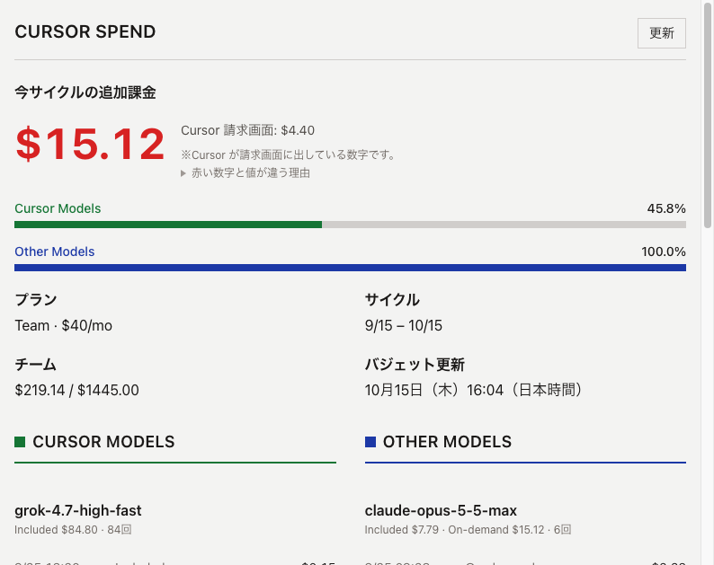

# cursor-spend

Cursor チームの利用量・追加課金をローカルブラウザで確認するダッシュボード。

Python 標準ライブラリのみ。ビルド不要。表示・更新に **追加の Cursor 課金は発生しない**。



## 画面の見方

| 表示 | 意味 |
| --- | --- |
| **大きな赤い数字** | 今サイクルで On-demand 課金が付いたイベントの `chargedCents` 合計 |
| **Cursor 請求画面: $X** | Cursor ダッシュボードの spend メーター（`individualUsed`）。集計方法が違うため、赤い数字と一致しないことがある |
| **▶ 赤い数字と値が違う理由** | 差の説明（Team プランでは特にズレやすい） |

下段は Cursor Models / Other Models の使用率バー、プラン・チーム・サイクル、モデル別の利用履歴。

## 必要環境

- macOS / Windows / Linux
- Python 3.10+
- Cursor デスクトップアプリに **ログイン済み**

## 使い方

```bash
git clone git@github.com:kke-me/cursor-spend.git
cd cursor-spend
python3 refresh.py --serve
```

http://127.0.0.1:8765/ を開く。`--serve` 中は **5分ごとに自動更新**。タブが非表示のあいだは止める。

5分より短い間隔では自動では取らない。すぐ見たいときは右上 **更新**（または `GET /refresh`）。

### 常駐させる（macOS・launchd）

ログイン時に自動起動し、落ちたら再起動する。ターミナルを閉じても動き続ける。

1. Python の実体のパスを調べる。pyenv の `shims` 経由ではなく、実体を指定する。

   ```bash
   python3 -c "import sys; print(sys.executable)"
   ```

2. `~/Library/LaunchAgents/com.example.cursor-spend.plist` を作る。`<PYTHON>` と `<REPO>` を置き換える。

   ```xml
   <?xml version="1.0" encoding="UTF-8"?>
   <!DOCTYPE plist PUBLIC "-//Apple//DTD PLIST 1.0//EN" "http://www.apple.com/DTDs/PropertyList-1.0.dtd">
   <plist version="1.0">
   <dict>
       <key>Label</key>
       <string>com.example.cursor-spend</string>
       <key>ProgramArguments</key>
       <array>
           <string><PYTHON></string>
           <string>refresh.py</string>
           <string>--serve</string>
       </array>
       <key>WorkingDirectory</key>
       <string><REPO></string>
       <key>RunAtLoad</key>
       <true/>
       <key>KeepAlive</key>
       <true/>
       <key>ThrottleInterval</key>
       <integer>30</integer>
       <key>StandardOutPath</key>
       <string>/Users/<you>/Library/Logs/cursor-spend.log</string>
       <key>StandardErrorPath</key>
       <string>/Users/<you>/Library/Logs/cursor-spend.log</string>
   </dict>
   </plist>
   ```

3. 登録する。手動で `refresh.py --serve` を動かしている間は、ポートが衝突するので止めておく。

   ```bash
   plutil -lint ~/Library/LaunchAgents/com.example.cursor-spend.plist
   launchctl bootstrap gui/$(id -u) ~/Library/LaunchAgents/com.example.cursor-spend.plist
   ```

4. 止める・外す。

   ```bash
   launchctl bootout gui/$(id -u)/com.example.cursor-spend
   ```

ログイン時に Keychain の許可ダイアログが 1 回出る。「今回のみ許可」を選ぶ。再起動や Python の更新があると、もう一度出る。

## 仕組み

```
Cursor (ログイン済み) → state.vscdb (accessToken)
  → refresh.py → api2.cursor.sh
  → snapshot.js → index.html
```

### 認証

Cursor がローカル保存したトークンを使う。API キー不要。

| OS | `state.vscdb` |
| --- | --- |
| macOS | `~/Library/Application Support/Cursor/User/globalStorage/state.vscdb` |
| Windows | `%APPDATA%\Cursor\User\globalStorage\state.vscdb` |
| Linux | `~/.config/Cursor/User/globalStorage/state.vscdb` |

`CURSOR_VSCDB` 環境変数でパス上書き可。トークンと `snapshot.js` は共有しない（`.gitignore` 済み）。

Cursor 3.x 以降、macOS ではトークンが `cursor-safe-storage:v1:` 付きで暗号化保存される。復号の鍵は Keychain の「Cursor Safe Storage」から取るため、起動時に macOS の許可ダイアログが出る。鍵は `refresh.py` 自身が Security.framework 経由で読む（`security` コマンドは使わない）。`--serve` 中は鍵をメモリに保持するので、自動更新のたびには聞かれない。

**「常に許可」は選ばない。** 許可は、読み取りを要求したプログラムに付く。`python3` に常に許可を与えると、同じインタープリタで動く他のスクリプトも鍵を読めるようになる。「今回のみ許可」なら、起動ごとに確認が出る。

### API

`https://api2.cursor.sh` — Cursor ダッシュボードと同系統の **非公開 API**。

| エンドポイント | 用途 |
| --- | --- |
| `GET /auth/full_stripe_profile` | チーム ID |
| `POST .../GetCurrentPeriodUsage` | サイクル・プール使用率・spend |
| `POST .../GetPlanInfo` | プラン |
| `POST .../GetFilteredUsageEvents` | 今サイクルの利用イベント（1,000 件 × 最大 20 ページ） |

### 集計

- サイクル: `billingCycleStart` / `End` を API に渡し、応答も同じ範囲で落とす
- Cursor Models: 末尾の括弧書き（` (Auto Balanced)` など）を外して小文字・ハイフンにしてから、プールフィールド、`autoBucketModels` / `default`、最後に `grok-` / `composer-` / `cursor-` / `vega`
- Other Models: 上記以外
- `USAGE_EVENT_KIND_ERRORED_NOT_CHARGED` と `USAGE_EVENT_KIND_ABORTED_NOT_CHARGED` は捨てる
- 知らない `kind` は合計に入れず `unknownKinds` に残す
- `individualUsed` があるときだけ、イベント合計との差が $0.05 以上なら `drift` を出す。フィールドが無いときは 0 とみなさない
- 20,000 件を超えて取り切れていないときは `truncated`

`drift` や未分類が出たら、`fixtures/payload.json` を今のレスポンス形に合わせて直し、テストを通す。

## テスト

```bash
python3 -m unittest
```

集計、トークン復号、HTTP サーバーの振る舞いを確認する。Keychain は本物に触れない（読み取りは差し替える）ので、テスト中に許可ダイアログは出ない。

## 制限

- 非公式 API（仕様変更で壊れる可能性）
- トークン所有者が閲覧できる範囲のデータのみ
- サーバーは `127.0.0.1:8765` のみ。外部には公開しない
- 自動更新は 5分間隔。それ以上の頻度は手動更新が必要
- macOS の復号は Keychain の許可に依存する。Linux / Windows では暗号化されたトークンを読めない（平文のトークンのみ対応）
- スリープ中は止まる。常時動かすには電源につなぎ、スリープを止める

## ライセンス

MIT
